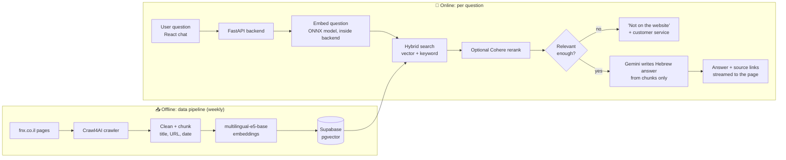

# 🔥 fnx-chatbot — a Hebrew RAG Chatbot

> A Hebrew question-answering chatbot that answers **only** from the public pages of [fnx.co.il](https://www.fnx.co.il),
> always shows its **source link**, and honestly says *"this is not mentioned on the website"* instead of guessing.

🌐 **Live demo:** [fnx-chatbot.vercel.app](https://fnx-chatbot.vercel.app/#/)
📊 **Reliability page:** [fnx-chatbot.vercel.app/#/stats](https://fnx-chatbot.vercel.app/#/stats)


---

## 📑 Table of contents
- [Why this project](#-why-this-project)
- [Features](#-features)
- [How it works](#-how-it-works)
- [Tech stack](#-tech-stack)
- [Reliability: measured, not claimed](#-reliability-measured-not-claimed)
- [Accessibility](#-accessibility)
- [Built with AI](#-built-with-ai)
- [Run it locally](#-run-it-locally)
- [Configuration](#️-configuration)
- [Deployment](#️-deployment)
- [Tests and evaluation](#-tests-and-evaluation)
- [Project structure](#-project-structure)
- [Known limitations](#️-known-limitations)

---

## 🎯 Why this project

In insurance, a wrong answer is a real risk. A general-purpose chatbot will happily invent policy details, so this
project is built around one rule: **no hallucinations**. Every answer comes from retrieved fnx.co.il content, carries
a link to where it came from, and is refused when the website does not contain the answer.

## ✨ Features

- 🔎 **Grounded answers** — Gemini writes the Hebrew answer from retrieved website text only, with the source URL.
- 🚫 **Honest refusals** — if nothing relevant is found, the bot says so and points to customer service.
- 🔗 **Source checking** — every cited link is verified to be among the pages actually retrieved.
- 🧠 **Hybrid retrieval** — vector search and keyword search together, with optional Cohere reranking.
- 🛟 **LLM fallback chain** — Gemini, then Groq, then OpenRouter, so one provider's quota never stops the service.
- ⚡ **Streaming answers** — text appears as it is written.
- 🔄 **Automatic data refresh** — a weekly GitHub Actions job re-crawls and re-embeds only new or changed pages.
- 📊 **Public reliability page** — measured accuracy numbers from an automated test set (see below).
- ♿ **Accessibility suite** — read-aloud with word highlighting, voice input, high contrast, text size and more.
- 🛡️ **Safeguards** — rate limiting, input length limits, retries with exponential backoff, answer cache,
  spelling correction, and a rule that the bot never recommends a medicine or treatment.

## 🧩 How it works



**The two paths are separate on purpose.** Crawling and embedding are slow and run offline, so users never wait for
them. Answering is fast: embed the question, search the database, and make one LLM call. The website itself is never
contacted while answering.

## 🧰 Tech stack

| Layer | Technology | What it does here |
|---|---|---|
| **Language** | Python 3.11 | Crawler, data pipeline and backend |
| **Crawling** | Crawl4AI (Chromium) | Reads fnx.co.il pages, including JavaScript pages, politely and within `robots.txt` |
| **Embeddings** | sentence-transformers, `intfloat/multilingual-e5-base` | Turns text into 768-number vectors; works in Hebrew; runs locally at no cost |
| **Model runtime** | ONNX Runtime, SentencePiece, NumPy | A compact copy of the embedding model so the live server fits in 512 MB |
| **Vector database** | Supabase (PostgreSQL + pgvector) | Stores chunks and vectors; vector and keyword search |
| **Backend** | FastAPI, Uvicorn | REST API (`/chat`, `/chat/stream`, `/health`) in layers: controllers, services, repositories, models |
| **Answer model** | Google Gemini (`google-genai`) | Writes the Hebrew answer from the retrieved text |
| **Fallback models** | Groq (Llama 3.3 70B), OpenRouter | Take over if Gemini fails or runs out of quota |
| **Reranking** | Cohere Rerank (`rerank-v3.5`) | Optional: re-orders the found chunks by fit |
| **Frontend** | React 18, Vite | Right-to-left Hebrew chat interface |
| **Styling** | Plain CSS with design tokens | Light/dark mode, high contrast, reduced motion |
| **Browser APIs** | Web Speech, CSS Custom Highlight, `localStorage` | Read-aloud, voice dictation, word highlighting, saved settings |
| **Testing** | pytest, Vitest, Testing Library, jsdom | Backend and frontend automated tests |
| **Containers** | Docker (multi-stage) | Builds the backend image without PyTorch |
| **Hosting** | Render (backend), Vercel (frontend) | Free-tier deployment |
| **Automation** | GitHub Actions | Weekly data refresh |
| **Source control** | Git, GitHub | Version history |
| **AI development** | Claude Code | AI pair-programmer used throughout (see below) |

## 📊 Reliability: measured, not claimed

The project includes an automated evaluation (`scripts/eval_e2e.py`) that asks the bot a fixed set of questions and
scores the results. The numbers are shown publicly on the **reliability page** (`#/stats`, "מדד האמינות").

Latest clean run (2026-10-21), on the project's own test set:

| Check | Result |
|---|---|
| Answerable questions answered correctly | **20 / 21** |
| Out-of-scope questions correctly refused | **7 / 9** |
| Right source page found by retrieval | **20 / 20** |

These figures come from a small, hand-checked question set. They show how the bot behaves on that set, not a
guarantee for every possible question. Known misses are listed under [limitations](#️-known-limitations).

## ♿ Accessibility

Built with WCAG 2.1 AA and the Israeli standard ת"י 5568 as the goal:

- 🔠 Adjustable text size, high-contrast mode, and a reduce-motion switch
- 🔊 Read-aloud for answers, with the current word highlighted, plus optional auto-read
- 🎙️ Voice input for questions
- ⌨️ Full keyboard use, visible focus, and a "skip to the question box" link
- 🗣️ Screen reader labels and live announcements for new answers
- ✂️ Select any text in an answer and ask a follow-up about it
- 📄 An accessibility statement page (`#/accessibility`)

> The site has **not** been audited by an external accessibility consultant, and the statement page says so.

## 🤖 Built with AI

This project was built by me **together with AI tools**, and I want to be open about how:

- **Claude Code** (Anthropic) was my pair-programmer for writing, refactoring and testing code, working under a
  written set of project rules: explain the plan first, list the files, change nothing without approval, and work one
  small step at a time.
- **Google Gemini**, with **Groq** and **OpenRouter** as backups, powers the chatbot's answers at run time.
- The design decisions are mine: the architecture, the "answer only from the website" rule, the choice of a local
  embedding model, the evaluation approach and the safeguards. Each is recorded in [DECISIONS.md](DECISIONS.md), and
  the results are checked by tests and by the measured evaluation above.

## 🚀 Run it locally

**Requirements:** Python 3.11, Node.js 18+, a Supabase project, and a Gemini API key.

```bash
# 1. Backend
python -m venv .venv
.venv\Scripts\activate            # Windows (use: source .venv/bin/activate on macOS/Linux)
pip install -r requirements.txt
copy .env.example .env            # then fill in your keys
uvicorn backend.main:app --reload --port 8000

# 2. Frontend (in a second terminal)
cd frontend
npm install
npm run dev
```

To fill the database with website content, run the pipeline once:

```bash
python -m backend.ingestion.run
```

It crawls, chunks, embeds and uploads. Running it again only processes new or changed pages, and never creates
duplicates.

## ⚙️ Configuration

Secrets live only in `.env` (or the hosting dashboard) and are never committed. See [.env.example](.env.example).

| Variable | Purpose |
|---|---|
| `GEMINI_API_KEY`, `GEMINI_MODEL` | Main answer model |
| `SUPABASE_URL`, `SUPABASE_KEY` | Vector database (use the secret service-role key, backend only) |
| `GROQ_API_KEY`, `OPENROUTER_API_KEY` | Backup models (skipped if empty) |
| `COHERE_API_KEY` | Optional reranking |
| `CORS_ORIGINS` | Web addresses allowed to call the API (backend) |
| `VITE_API_URL` | Backend address (frontend) |
| `MAX_QUESTION_CHARS`, `RATE_LIMIT_REQUESTS`, … | Optional safeguards with sensible defaults |

## ☁️ Deployment

- **Backend:** Render (free web service), built from the [Dockerfile](Dockerfile), health check at `/health`.
- **Frontend:** Vercel, root folder `frontend`.
- **Memory trick:** a free server has 512 MB, and the full embedding model needs over 1 GB. The Dockerfile builds a
  compact ONNX copy of the *same* model in a first stage (with PyTorch), then ships only that copy in a small final
  image (about 300 MB at run time). Questions use the compact copy, documents use the full model, and the vectors
  stay compatible.
- **Data refresh:** [.github/workflows/refresh.yml](.github/workflows/refresh.yml) runs every Sunday and can also be
  started by hand.

## 🧪 Tests and evaluation

```bash
pytest                              # backend tests
cd frontend && npm test             # frontend tests
python scripts/eval_e2e.py          # full question-set evaluation (uses LLM quota)
python scripts/eval_retrieval.py    # retrieval quality only
python scripts/eval_attacks.py      # prompt-attack attempts
```

> `eval_e2e.py` makes many LLM calls, so avoid repeated runs on free-tier quotas. The evaluation question set is kept
> local and is not part of the repository.

## 📁 Project structure

```
backend/
  main.py, config.py
  controllers/     HTTP layer only
  services/        chat, retrieval, rerank, generation, LLM fallback, stats
  repositories/    Supabase access only
  models/          typed schemas
  ingestion/       crawler, chunker, embed + upload, refresh pipeline
  utils/           retry, rate limit, answer cache, spelling
frontend/src/
  components/      chat, message, sources, stats page, accessibility menu and statement
  hooks/           accessibility settings, speech, dictation, chat state
  styles/          design tokens, base styles, accessibility styles
scripts/           evaluation, checks, ONNX model builder
supabase/          database schema
tests/             backend tests
.github/workflows/ weekly data refresh
```

## ⚠️ Known limitations

- Between weekly refreshes, the bot may show outdated information.
- Answers are written by AI from website text and **can contain errors**. They are not binding; for binding details,
  contact fnx customer service.
- On a few questions outside the website's content, the bot still answers instead of refusing (for example,
  driving-licence renewal).
- Read-aloud uses the device's voice, so quality depends on whether a Hebrew voice is installed.
- Free-tier hosting means the first request after idle time can be slow.

---

<sub>This is an independent project built for educational and demonstration purposes using only publicly available
fnx.co.il content. It is not an official fnx product.</sub>
